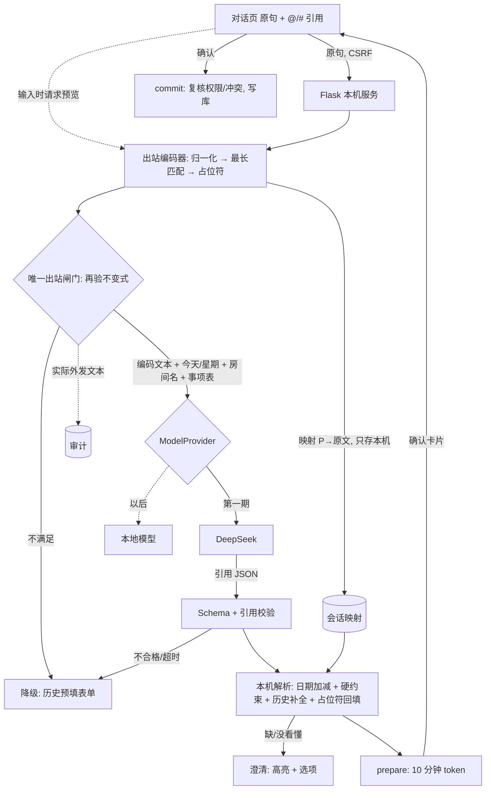

# 「一句话预约」设计文档 V2：白名单出站编码 + 模型只给引用

> 适用代码库：`frankfang2009/meeting-room-reservation-system`，`v2/`
> 版本：V2 · 2026-10-20（Codex 第七轮：词表词携带候选值，本机只核对、不推断。这取代「删除全部本地时间规则」的字面要求） · 作者：Grok Bot（为 Frank 整理）
> 关系：**取代** `AI-BOOKING-DESIGN.md` 的 §4（脱敏网关）、§5（意图 JSON）、§6 中的时间解析、§14 的验收口径；其余（对话页、历史、接口外形、数据表、权限审计、合同修订）**沿用原文**，本文只写变化。
> 示例数据全部为虚构。日期示例以「今天 = 2026-10-19 周一」为基准。
> 本文随 #62 入库，供评审对照。界面稿里的图片路径仍指向设计时的 mockup，不在本仓库。

---

## 0. 一页摘要

- **从“黑名单脱敏”改为“白名单编码”**：不再猜哪些是人名、案号；只有预约领域词表里的词才能出本机，其余任何连续片段一律换成 `[P1]`、`[P2]`……。唯一不变式：**每个外发词元要么在词表里，要么是占位符**，用性质测试/模糊测试证明。
- **模型只给“引用”，不给“值”**：模型输出相对日期、开始时间/时段、时长、房间、事项，以及 `refs`（如 `P1 = 被询问人`、`P2 = 案号`）和证据位置。模型只能指向占位符，生成不出任何当事人或案号；本机把用户自己的原文填回去。所以**新案子、新当事人也能填上，却从未发出去**。
- **值绑定到证据**（负责人 2026-10-20 确认，取代「删除全部本地时间规则」的字面要求）：钟点、日期、时长、时段词在出站时带上候选值（「十点」→ `{10:00, 22:00}`，「14:15」→ `{14:15}`，「明天」→ 偏移 1，「一小时」→ 60 分钟）。本机只核对模型给出的值是否落在被引用词元的候选集里，并且每个字段值都有引用；对不上就澄清、不发凭证。本机不从句子另推一个时间。日期加减、工作时间、时长上下限、不能约过去，仍是配置里的业务硬约束。没说的房间、时长、当事人、事项，从本人历史统计补全。
- **验收拆开**：S1 隐私不变式、S2 授权（prepare/commit）、S3 业务硬约束，三项都必须 100%；Q 理解质量在冻结的约 150 句语料上 ≥90%，是**指标**，不按缺陷（P1/P2）管理。
- **保留**：prepare/commit + 10 分钟、绑定用户的 token；提交时复核权限与冲突；审计只记外发编码文本；默认关闭、管理员开启；事项必填（422）；冲突 409。
- **界面新增**：外发预览（默认收起）、`@` 选人 / `#` 选案号、"没看懂"高亮 + 快捷选项、确认卡片（绝对日期 + 星期、结束时间醒目、淡色原话）。接口不可用或功能关闭时，退回用历史预填的表单。

---

## 1. 数据流



只有 DeepSeek 节点在本机之外。它能看到的只有：编码后的句子、业务日期与星期、当前钟点、启用房间名、事项列表、固定指令。工作时间留在本机硬约束里，不写进提示词。

---

## 2. 出站编码器（替代 `deid.py`）

### 2.1 步骤

1. **归一化**：NFKC；全角转半角；连续空白合并成一个空格。保留每个字符到原文的下标映射，回填时用**原文**（而不是归一化后的文本）。
2. **引用片段先占位**：用户用 `@`/`#` 插入的引用（前端以结构化 `refs` 随消息提交）直接成为占位符，不进入分词。
3. **正向最长匹配**：对剩余文本按词表做最长优先匹配；数字与数字+单位由 §2.3 的小语法匹配。
4. **数字词的边界**：语法放出的数字词（不在词表里的 `14:15`、`3号`、`10月`）两边都必须是词表词、标点、空白或字符串边界，否则并进旁边的占位符。「案号」不算安全的左邻，所以「案号12号」不放出「12号」。另一枚数字文法词可以当边界，因此「10月20日」仍是两个词。词表里的「十点」「一小时」不受这条限制。
5. **占位**：任何连续的未命中片段（中间只隔括号、连字符、斜杠、点、数字的也算同一段）合并为一个占位符，按首次出现编号 `[P1]`、`[P2]`……；**同一原文片段 → 同一占位符**。发送时带上本会话已有的占位映射（`prior`），所以后一句里的同文片段继续用同一个编号。
6. **输出**：词元数组（时间类词元带候选值，见 §3）+ 以空格连接的文本 + 映射 `{P1: 原文片段}`。映射只存在于本机（请求内存、会话记录、prepared booking），**永不外发、不进审计**。

示例（用户输入，含两个引用）：

| | 内容 |
|---|---|
| 原句 | 后儿晚上给 @孙某 做个笔录，#(2024)沪0101民初1234号 那个案子，笔录室2，半个钟头 |
| 外发 | `后儿 晚上 给 [P1] 做个 笔录 ， [P2] 那个 案子 ， 笔录室2 ， 半个钟头` |
| 本机映射 | `P1 → 孙某`，`P2 → (2024)沪0101民初1234号` |

不用 `@`/`#` 时结果相同：“孙某”中的“孙”“某”都不在词表；“(2024)沪0101民初1234号”整段未命中（4 位数字不放行，单独的“号”不在词表），各自合并成一个占位符。

### 2.2 词表（有限、可审阅、随版本发布）

| 类别 | 内容 | 来源 |
|---|---|---|
| 时间词 | 今天/明天/后天/后儿/大后天/明儿、上午/下午/中午/晚上/早上/傍晚、本周/下周/周一…周日/礼拜一…、月初/月底、一会儿等 | 固定清单 |
| 数字+单位 | §2.3 语法生成，如 `3点`、`两点半`、`20号`、`10月`、`90分钟`、`半个钟头`、`一小时` | 语法 |
| 房间名 | 启用房间及变体（`笔录室 2`/`笔录室2`/`2号笔录室`） | `rooms.name`，运行时载入 |
| 预约动词/名词 | 约、订、预约、找、要、留、取消、改、换、做个、补个、笔录、询问、谈话、调解、案子、房间、会议室、空 | 固定清单 |
| 事项名 | 配置中的事项列表（如 询问笔录、谈话笔录） | 配置 |
| 功能词 | 给、在、的、了、个、那个、这个、还是、一下、吧、吗、请、帮我、跟、到、至、从、左右、之前、之后…；句读 `，。、；！？` | 固定清单 |
| 引用标记 | `@`、`#` | 固定 |

**约束（构建期检查，CI 断言）**：
- 词表中**不得有常见姓氏单字**（`张`、`王`、`高`、`周`、`和`、`于`、`向`……，以百家姓前 400 为准）；单字词只来自一个封闭小清单，并与姓氏表求交为空。因此“孙某和李某”会合并成一个占位符，这是有意的代价。
- 词表变更只能通过代码评审；运行时只追加房间名与事项名（管理员配置，本来就是公开信息）。

### 2.3 数字规则

所有会带出数值的词元共用**一笔**预算。ASCII、全角（NFKC 之后）和中文数字一视同仁；中文数字按它表示的十进制位数计（「五」算 1 位，「十五」算 2 位），不再是零成本。一条消息最多：

| 种类 | 上限 | 取值 |
|---|---|---|
| 日期表达 | 1 | `YYYY-MM-DD`、`M/D`、`M-D`，或 `N月` 再接一个 `N日`/`N号`。月 1–12，日 1–31，并且 `date()` 认这是真日期。四位年份只允许出现在完整的 `YYYY-MM-DD` 里，并且只能是服务器当年或下一年。`1990-1-1`、`2026-02-31`、`1381-2-3` 不放行 |
| 时刻 | 2 | `HH:MM`，或 `N点`、`N点半`、`N点N分`。小时 0–23。分钟只允许 **00 / 15 / 30 / 45** |
| 时长 | 1 | 15–180 分钟，且是 15 的倍数（含 `90分钟`、`120分钟`、`1.5小时` 和词表里的「一个半小时」「两个小时」） |
| 日号 | 1 | `N号` 只表示日，1–31。第二个「号」变成占位符 |
| 房间序号 | 1 | 只能复述本次启用房间已经公开的号，例如「2号房间」；不能是任意数字 |
| 数字字符 | 16 | 上面这些词元的数字位数合计 |

分钟取 00/15/30/45，是因为预约格子是 30 分钟：00 和 30 可以直接落槽，15 和 45 是用户会写的刻钟，看见之后必须澄清（§4.2），不能当成任意两位分钟放行。不采用「5 的倍数」：05、10、20、35 这类值既不能直接预约，又让 `13:35`、`12:40` 这类片段多藏一对数字。

`13:38`、`12:34`、`13:81`、`6:7`、`14:00:30`、`10/28/2026` 不合格。`5点6点7点` 只留下前两个时刻。`一号三号八号…` 只留下第一个日号。`200分钟`、`3.5小时`、`90点`、`1234号` 遮盖。`天`/`周` 不再作为数字单位，避免 `3周` 漏出数字；「半天」仍是词表词。

**一句里的数字文法有多大。** `numeric_capacity_bits()` 只描述**一条消息**：`date()` 认的当年与下一年 ISO 日期个数，和 12×31 取较大者，加上两个时刻（各 `24×4`）和 12 档时长。2026-10-20 当天是非闰年，两年共 730 个 ISO 日期，大于 372，所以是 `log2(730) + 2×log2(96) + log2(12)`，约 **26.27 比特**。房间序号只是在重复已经放进提示词的房间号，不另计。换一句可以再送满额的一笔，词表选词（「明天」「下午」「笔录」）也不走这笔预算，所以它**不是**电话、证件号或案号的上界。它只挡住一句里偶然拆开的数字碎片。性质测试断言：同一句里释放出的数字串拼不出原先那条 ≥7 位的秘密；两句拼在一起可以超过 16 位，这是预算的边界，不是漏洞修复的对象。

### 2.4 不变式与闸门

> **I1**：对任意输入，外发载荷里的每个动态词元 `∈ Lexicon ∪ {[P1]…[Pn]}`，且整包数字满足 §2.3。系统提示里的固定规则是审过的常量，不参与数字预算。

- 不变式覆盖**整包**出站文字：系统提示、服务器上下文、用户编码句。历史里的事项自由文本（例如「询问孙某，电话13812345678，案号CASE-2026-087」）不得拼进系统消息。外发事项只能是代码里的类别（询问笔录、谈话笔录、调解笔录、会见、谈话、开会），或者不发。卡片上的事项仍由本机从本人历史填，不经过模型。
- `assemble` 是唯一组装出站消息的函数。每一段动态字符串都要过 `release_outbound` 或服务器上下文校验。`encode_preview` 返回的是同一份动态出站内容。
- 编码器之后还有**唯一出站闸门**（`ModelProvider` 发 HTTP 前的最后一个函数）**独立再验一次 I1**；不满足就不发，记 `outcome="blocked_invariant"`，界面走降级。这是唯一能对外发请求的代码路径（测试断言没有其他代码会 import HTTP 客户端）。
- 审计只记录闸门放行的编码文本。

### 2.5 测试计划（S1）

| 层 | 做法 | 通过标准 |
|---|---|---|
| 性质测试 | Hypothesis 生成：词表词 + 随机汉字/姓名/字母/emoji/全角/零宽字符/超长数字/混合括号的任意拼接，断言 I1 | 10 万例 0 失败 |
| 模糊测试 | 对编码器入口跑覆盖导向的 fuzz（atheris），断言 I1、不抛异常、同输入同输出 | 夜间任务 0 失败 |
| 金丝雀 | 注入随机姓名、案号、手机号、身份证号，断言它们的任何 ≥2 字子串只要不是词表词就不出现在外发文本 | 0 泄漏 |
| 词表检查 | 词表 ∩ 姓氏单字 = ∅；无 ≥3 位数字词；房间名变体只由配置生成 | CI 断言 |
| 闸门 | 伪造违规文本直达闸门 → 必须拦截；静态检查无第二条出站路径 | CI 断言 |
| 金样例 | 约 60 条：本文示例、司法案号各种括号、电话、证件号、全角数字、“周五”类名字 | 逐字比对 |

---

## 3. 模型输出：只给引用和证据

模型使用 JSON 输出模式，schema 固定，**不存在自由文本字段**（不再有 `notes`、`purpose_hint`）：

```json
{
  "intent": "book",
  "day":      { "offset": 2 },
  "start":    { "period": "evening", "time": null },
  "duration": { "minutes": 30 },
  "room":     "笔录室2",
  "purpose":  "询问笔录",
  "refs": [ { "ph": "P1", "role": "被询问人" },
            { "ph": "P2", "role": "案号" } ],
  "evidence": { "day": [0], "start": [1], "duration": [13], "room": [11], "purpose": [4, 5] },
  "unknown":  [],
  "missing":  []
}
```

| 字段 | 取值 | 说明 |
|---|---|---|
| `day` | `{offset:n}` \| `{week_offset:n, weekday:1–7}` \| `{month, day}` \| `null` | 模型不做日期计算，也不输出 ISO 日期 |
| `start` | `period ∈ {morning, noon, afternoon, evening, any}` 和/或 `time: "HH:MM"` | 时段词**只约束开始时间**（见 §4.2） |
| `duration.minutes` | 整数或 `null` | 本机校验上下限与 30 分钟对齐 |
| `room` / `purpose` | 必须是上下文所给列表中的一项或 `null` | 不在列表即丢弃 |
| `refs[].ph` | 必须是本条外发中出现过的占位符 | 指不到就丢弃 |
| `refs[].role` | `被询问人` \| `当事人` \| `案号` \| `其他` | |
| `evidence` | 字段 → 外发词元下标 | 用于卡片上的“原话”和一致性检查 |
| `unknown` | 模型认为跟时间/房间等有关、但看不懂的占位符或词元下标 | 驱动"没看懂"澄清 |
| `missing` | `⊆ {day,start,duration,room,party,case,purpose}` | 澄清文案由本机模板生成 |

每个放行的钟点、日期、时长、时段词元带一组候选值。同一键的多个值是「或」（「十点」是 `time:10:00` 与 `time:22:00`），不同键是「与」（「下周四」同时是 `week_offset:1` 和 `weekday:4`）。「一小时」的类别仍是 `clock`，候选键是 `minutes`。单独的「30分」是 `minute:30`，被引用的 `HH:MM` 必须带这个分钟。

**校验（替代原“输出后检查”，也取代「删除全部本地时间规则」）**：JSON/schema 合法；所有 `ph` 存在；`evidence` 下标在范围内，类别与字段相符。在此之上做**值绑定**：每个带候选值的词元必须被某个字段引用，并且该字段的值落在候选集里；字段里每个成分（偏移、星期、月、日、时刻、分钟、时段、时长）也必须有引用。对不上就澄清，**不发凭证**，也不把值吸到最近的格子上。本机只做这个核对，不从原句再推断一个时间。房间和事项仍只核对类别与上下文列表。因为输出里没有自由文本，原来“字面后检查”整段删除。

---

## 4. 本机解析

### 4.1 回填规则

1. `refs` 中的占位符 → 用户**原文**片段（按 §2.1 下标映射截取，去掉首尾空白）。来自 `@`/`#` 引用的，用引用条目的规范值。
2. 角色以引用类型为准：`@` 只能当人，`#` 只能当案号；模型给的角色与之冲突时，以引用类型为准并记一次 Q 失误。
3. 同一角色出现多个占位符 ⇒ 澄清（“是哪位？”列出原文片段）。
4. **当事人/案号的来源顺序**：本句占位符 > 本人历史（`owner_user_id = 本人`）。案号回填后若命中本人历史，带出标签、当事人、事项；未命中，按新案号原样使用（≤120 字），不去套别人的案子。
5. `role = 其他` 的占位符不进入任何字段。

### 4.2 日期与硬约束（唯一保留的本地逻辑）

- 日期：`offset`/`week_offset+weekday`/`month+day` 按服务器业务日期（`common.py::local_now()`）计算；早于今天或超过 60 天 ⇒ 澄清。
- 时段 → **开始时间窗口**来自配置表（如 `afternoon = 12:00–17:30`，`evening = 18:00–`），不是解析规则。开始时间必须落在窗口内；结束时间可以越过窗口，但不能越过工作时间。
- 业务硬约束（来自 `system_settings`，与 `reservations.py::_validate_booking_payload` 同一套）：工作时间 08:30–17:30、时长 30–180 分钟且按 30 分钟对齐、不能约过去、房间启用。
- 值已经绑定之后，用户说出的时间、日期或时长若落在格子或工作时间外，本机只给最近的合法选项并**不发凭证**。这是在改一个已经核对过的值，不是从句子里推断新时间。例如「明天18:30」绑定到 18:30 之后提供 16:30–17:30；「明天14:15」提供 14:00；「明天07:00」提供 08:30。模型若把这些值改成别的钟点、把日期偏移改掉，或在证据没有时刻时填上 08:30 / 12:00，绑定失败，同样只澄清、不发凭证。时段和工作时间没有交集时只给选项（晚上半小时 → 17:00–17:30）。没说钟点、只说了「下午」，并且「下午」的候选值被引用时，开始时间仍取该时段在工作时间内的起点。
- 后一句不继承上一张卡片的字段。占位符编号通过 `prior` 在会话内保持稳定；时间、房间、时长必须在这句里重新说清或重新点选。澄清作废上一张未确认的凭证，不能靠后一句把澄清变成卡片。
- 历史补全（未说明时）：房间 = 该案号/当事人最近用的 > 本人近 90 天最常用 > 排序第一；时长 = 本人同类事项的中位数，否则 60；事项 = 该案号上次事项；当事人 = 该案号上次当事人。补全的字段在卡片上加点状下划线。降级表单的 `formPrefill` 用本人最近一条未结束预约的房间、时长、当事人、案号、事项。

---

## 5. 验收

| 项 | 内容 | 方法 | 标准 | 性质 |
|---|---|---|---|---|
| **S1 隐私** | 不变式 I1、闸门唯一、审计只记编码文本、映射不外发 | §2.5 全部 | **100%** | 门禁，失败即阻断合并 |
| **S2 授权** | prepare/commit、token 10 分钟且绑定用户、提交时复核权限与冲突、重放/过期/跨用户 | 现有 `test_quick_booking.py` 用例沿用 | **100%** | 门禁 |
| **S3 业务约束** | 工作时间、时长、对齐、不约过去、事项必填 422、冲突 409 | 单测 + 对模型输出做随机变异（任意 day/start/duration）后断言不会产出违规卡片 | **100%** | 门禁 |
| **Q 理解质量** | 冻结语料约 150 句（相对日期、星期、时段、口语时长、方言如“后儿”、房间、新/旧当事人与案号、缺信息、组合句），整卡片字段全对算对。一次就能出卡片的良性句子另计一张卡片率，不并进这个比例 | `scripts/eval_quick_booking.py` 用真实供应商跑 3 次取多数，**不进 CI**；没有密钥时直接退出。CI 用录制输出回放，下限 0.9 | **≥ 90%** | **指标**：按版本记录趋势，不开缺陷单、不分 P1/P2 |

Q 未达标的处理：补词表（需评审）、改提示词、换模型，或接受并在帮助中说明；不回到本地规则。

---

## 6. 界面变化

沿用已定稿的视觉系统（`foundation.css`，纸色底、细线、无大面积色块、无折角）。稿件源文件：`/workspace/mockup/chat/src/template.html`，截图脚本 `src/shoot3.sh`。

### 6.1 外发预览（默认收起）

输入框左下角只有一个小眼睛图标和“2 处只留在本机”。点开后在输入框内逐词显示“将发送”的内容，占位符画成灰块，下方一行小字说明灰块不会发出。预览与发送共用同一个归一化与长度入口（先去掉首尾空白，再按 500 字截断），`@`/`#` 的下标按去掉的前缀回退。发送后用户气泡下留一个更淡的眼睛图标，可回看实际发出的内容。


### 6.2 `@` 选人、`#` 选案号

输入 `@`/`#` 弹出候选，来源为本人历史（标“我的记录”）和用户目录（标“通讯录”），只在本机查找。插入后是**安静的行内引用**：极淡的中性底、灰色 `@`/`#` 前缀，不用标签色。引用是可选的：不用也会被白名单兜住，用了可以避免“名字恰好由词表词组成”的残余风险，并让角色确定。


### 6.3 "没看懂"澄清

模型在 `unknown` 里指出看不懂的占位符（例如方言“后晌”不在词表，被换成 `[P1]`），本机把对应原文在用户气泡里加暖色细下划线，回复「没看懂“后晌”，请选时间」，下面给出时间快捷选项；再用一行小字列出已经听懂的部分。澄清响应带 `spans`（字段、起止、被引用的原文）和 `options`。选项点击走 prepare，不再调用模型。


### 6.4 确认卡片 V2

确认数据带绝对日期、星期、开始和结束。卡片先写绝对日期和星期（10月21日 周三，淡色“后天”），再写大号的完整起止时间（结束时间与开始时间同等醒目），后跟时长；下面用淡色小字列出“原话”证据「后儿晚上」「半个钟头」，被调整时说明原因。字段行：房间、事项（必填）、当事人、案号；自动补全的仍用点状下划线。


### 6.5 降级：历史预填表单

接口不可用、超时、闸门拦截或功能关闭时，回复一句说明并打开现有预约表单。`formPrefill` 填本人最近一条未结束预约的房间、时长、当事人、案号和事项。未出稿。

管理员开启外部模式必须另行接受外发告知（`external_notice`）。接受之后才记下接受人和时间。`retention_days` 到期后清除 `draft_json`，并删除过期的 `prepared_bookings`。

---

## 7. 与现有 3 个 PR 的差异

| PR | 现状 | 改为 |
|---|---|---|
| **#62** 脱敏网关 | 黑名单：姓名表、案号分层规则、电话/证件正则、“拿不准就不发” | **白名单编码器**（§2）：词表 + 数字语法 + 占位符 + 闸门再验；删除姓名/案号识别规则与 `deid-cases.json` 中依赖规则的断言，保留其中的输入作为金丝雀/金样例 |
| **#63** 模型意图 | 意图 JSON 含 `party_ref`/`purpose_hint`/`notes` 等文字字段；本地规则解析器；字面后检查 | **引用 + 证据 schema**（§3）；删除从原句推断时间的规则解析器与字面后检查。核对候选值是校验，不是那套规则。`ModelProvider` 接口与 `FakeProvider` 保留 |
| **#64** 编排 | 本地快速路径（规则能解析就不调模型）；当事人只从历史取 | **删除本地快速路径**，单一路径走模型；新增“本句占位符”作为当事人/案号来源（§4.1）；硬约束 + 历史补全；**prepare/commit、复核、审计、默认关闭、422/409 保留不动** |

---

## 8. 低预算实施顺序

1. **编码器 + 词表 + S1 测试**（改 #62）：纯函数，无依赖，先合并。
2. **schema 与校验 + 提示词**（改 #63）：删除规则解析器和后检查；用 `FakeProvider` 写单测。
3. **编排**（改 #64）：删快速路径，接回填与硬约束、历史补全；S2/S3 用例跑绿。
4. **冻结 Q 语料与评测脚本**：约 150 句，拿到 key 后跑一次出基线。
5. **界面**：先做确认卡片 V2 与"没看懂"（直接影响可用性），再做外发预览，最后 `@`/`#`（可选，可延后）。
6. **降级表单预填**：复用现有表单，只加预填。

每步独立可合并，CI 只依赖 `FakeProvider`，不联网。

---

## 9. 残余风险

1. **名字里由词表词组成的部分**会以这些词外发。完全由词表词组成的名字（如「周五」），以及名字中本身是词表词的片段（「张会」→ `[P1] 会`，「高明天」里的「明天」），都在此列。**负责人于 2026-10-20 确认接受。** 理由：这种片段和预约词无法区分；挡住星期词会让「周五上午」也不能约。缓解仍是 `@` 引用。姓氏单字不入词表，所以姓本身不会作为单字放行。词表里已收紧的部分：裸的「一个 / 两个 / 三个」不再当功能词（避免零成本拼数字），`天`/`周` 不再当数字单位，`N号` 只表示 1–31 的日且每条只有一个。星期词保留。
2. **元数据外发**：时间、房间名、事项名、“笔录”这类词，以及占位符个数（暴露“有几个人/案号”）会发出去。管理员配置的房间名会原样进入服务器上下文，只检查长度，不因为像姓名就拒绝。这是功能所需，写入管理员告知。
3. **理解失误**：模型把案号标成当事人等。卡片展示、用户确认兜底；引用类型优先（§4.1-2）；计入 Q。
4. **词表覆盖不足**：方言、新说法会被遮住，导致"没看懂"。按 Q 结果评审后补词；不能用线上原文补词（原文不留存），只能用冻结语料与人工收集。
5. **供应商留存**：外发文本可能被供应商留存。范围已由 I1 限定，条款核对沿用原文 §17-1。
6. **好处**：非词表文本无法外发，因此用户粘贴进来的任何指令文字也到不了模型，提示注入的面很小。

## 10. 待定问题

1. `@`/`#` 引用是否把标记一起外发（`@[P1]`）。外发能提高 Q，标记本身也在词表里；本文示例按不外发处理，以 Q 评测结果决定。
2. 是否允许用户把“后晌 = 下午”记成个人同义词（本机替换后再编码）。这能减少重复澄清，但相当于一条本地规则，暂不做。
3. ~~数字上限 8 是否够用~~。第六轮改为 §2.3 的统一额度。第七轮按真实日期重算，2026-10-20 当天约 26.27 比特，且只覆盖一句里的数字文法。「10月21日 17点 30分」是 1 个日期加 2 个时刻，在额度内。

## 11. 长期：推广到 agent 框架

同一思路可以推广为通用约束：数据分级（公开/内部/机密）、**唯一出站闸门**、工具返回引用而不是值、规划与执行分离（规划方只见引用，执行方在本机取值）、按供应商设置信任等级。与 DeepMind CaMeL、Simon Willison 的 Dual-LLM 模式思路一致。已评估同态加密、多方计算、可信执行环境、差分隐私：对“让外部模型听懂一句话”这一需求没有帮助，不采用。
